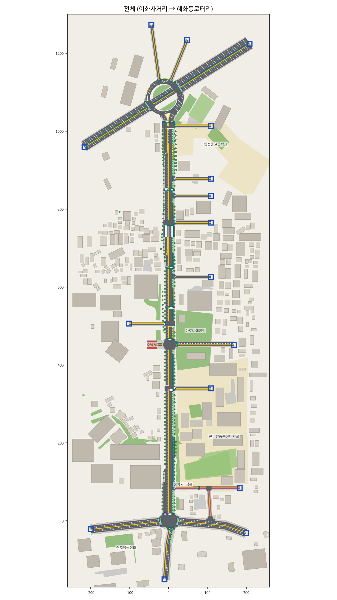
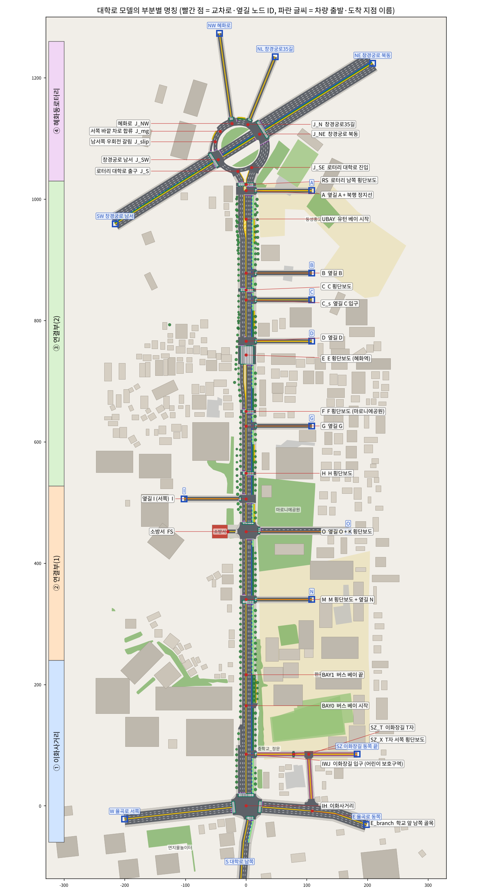
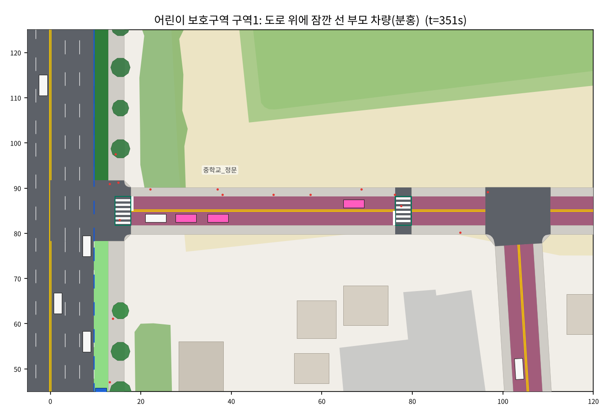
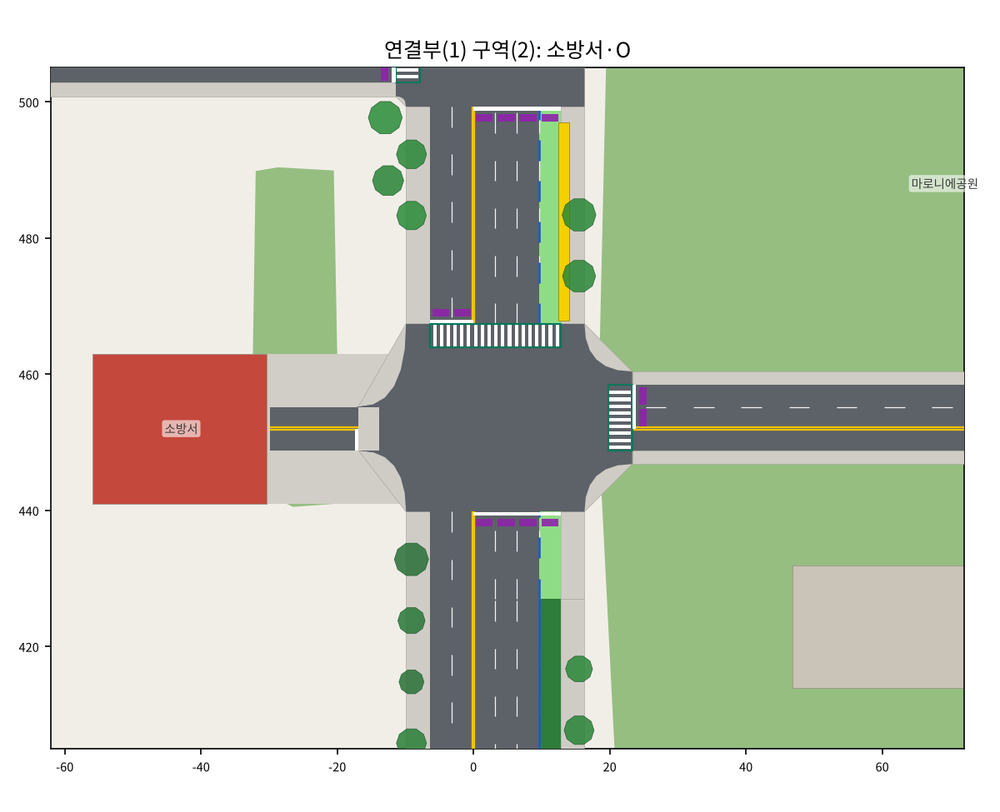
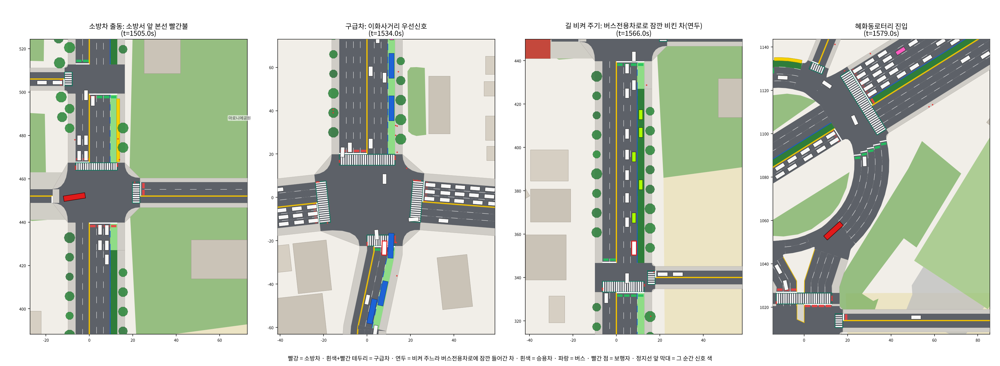
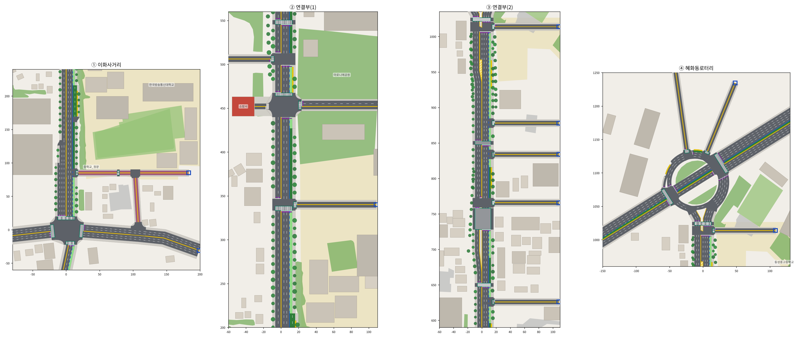
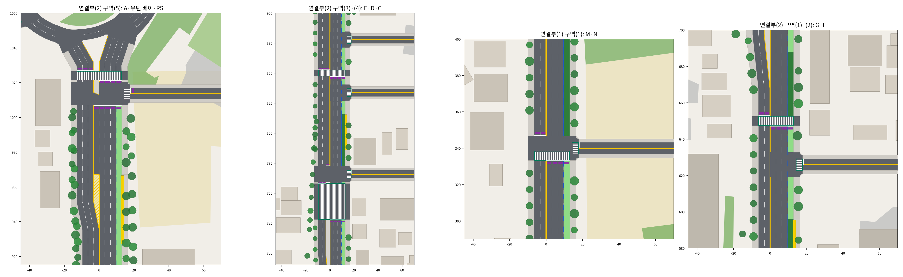
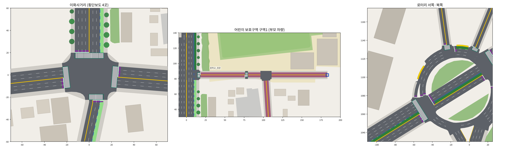

# 대학로 SUMO 도로 (이화사거리 → 혜화동로터리) — 최종본 (v4)

팀 그림("도로그림" 공통기호 + ①~④ 상세도, "수정부분1", "3-구역(3),(4),(5) 도로그림", "수정부분2", "도로그림(소방서)")을
SUMO 도로로 옮긴 것이다. 평일 오후 3시(중학교 하교 시간)의 대학로를 일반 차량·버스·부모 차량·소방차·구급차·보행자와 함께 재현한다.
학습한 자율주행차를 넣는 방법은 맨 아래 13장.



## 1. 한눈에 보기

| 항목 | 내용 |
|---|---|
| 범위 | 이화사거리(율곡로 × 대학로)에서 대학로를 따라 북쪽으로 약 1km, 혜화동로터리까지. 팀 그림 ① 이화사거리 · ② 연결부(1) · ③ 연결부(2) · ④ 혜화동로터리 (3장) |
| 시간 | 평일 15~16시, 1시간, 0.5초 간격(수업 환경과 같음) |
| 도로 | 교차로·차로 경계 노드 53개, 도로 조각 88개, 신호 14곳, 횡단보도 26곳, 버스정류장 7곳, 대학로 북행 버스전용차로(점선·실선 구간), 북행 버스 베이·유턴 베이, 어린이 보호구역(이화장길, 30km/h), 소방서 |
| 차량 | 시간당 약 5,600대: 승용차(운전 모델 Krauss·IDM·EIDM·ACC), 버스 6개 노선 260대, 부모 차량 68대, 소방차·구급차(1500초 사이렌 출동 2대 + 사이렌 없이 시간당 6대). 교통량은 2025 서울시 교통량 조사 A-07(대학로)·A-06(창경궁로) 단면에 맞춤 |
| 보행자 | 시간당 5,440명 (중학교 정문 하교 학생 500명 포함) |
| 장면 | ① 하교 시간 어린이 보호구역: 부모 차량이 구역1 도로 위에 10·15·20초 섰다 감 ② 1500초 출동: 소방차(소방서 → 혜화로)·구급차(이화사거리 남쪽 → 창경궁로)가 버스전용차로·신호 무시·제한속도 초과, 다른 차는 옆 차로(버스차로 포함)로 비켜 주고, 신호는 긴급차량 우선신호 |
| 검증 | seed 1~16 + 42, 각 1시간: 텔레포트 0회, 3분 넘게 계속 멈춘 차 0대, 긴급차가 낀 충돌 0건 (9장) |
| 실행 | `python view_daehakro.py` (sumo-gui), `--nogui` (1시간 점검표), `--plot` (그림) — 2장 |

## 2. 실행

```bash
python view_daehakro.py                  # sumo-gui로 열기 (▶ 버튼으로 재생). 1500초에 소방차·구급차 출동
python view_daehakro.py --plain          # 긴급차 보조 없이 SUMO 파일만으로 열기 (비교용)
python view_daehakro.py --nogui          # 화면 없이 1시간 돌리고 점검표 출력 (차량·버스전용차로·유턴·부모 차량·긴급차량·보행자)
python view_daehakro.py --nogui --seed 7 # 다른 난수로 점검
python view_daehakro.py --plot           # 도로망 그림(PNG) 저장 (matplotlib 필요)
python utils/plot_daehakro.py --names           # 부분별 명칭 그림 (daehakro_names.png, 3장)
python utils/plot_daehakro.py --snapshot 1500   # 1500초 시점의 차량·보행자·신호 색까지 그림
python utils/plot_daehakro.py --emergency       # 소방차·구급차 출동 장면 4칸 (daehakro_emergency.png)
python utils/plot_daehakro.py --snapshot 351 --views school   # 어린이 보호구역 구역1만 (부모 차량이 도로 위에 선 장면)
python view_daehakro.py --netedit        # netedit로 도로망 보기
```

- 실행할 때마다 `env/daehakro_config.py`를 읽어 `env/sumo/daehakro/` 안의 SUMO 파일을 **새로 만든다**.
  도로·신호·교통량을 바꾸려면 config 파일만 고치면 된다 (12장).
- SUMO 1.27.1에서 만들고 시험했다. 1시간 시뮬레이션은 화면 없이 1~2분(점검표 포함).
- **sumo-gui는 TraCI로 연다** (긴급차 보조·꼬리물기 방지 `env/daehakro_emergency.py`가 매 스텝 돌아야 해서). 화면 사용법은 그대로이고,
  GUI의 다시 불러오기(Reload) 대신 창을 닫고 다시 실행하면 된다.
- 출동 장면만 보려면 sumo-gui에서 Delay를 0으로 두고 메뉴 Edit → Breakpoints에 `1495`를 넣은 뒤 ▶ (1495초에 멈춤).
- 수업 기본 코드(`road_builder.py`, `view_road.py`, `env/sumo_env.py`)는 건드리지 않았다.

## 3. 전체 구성 (overview)



빨간 점은 교차로·옆길 노드(모델 ID와 이름), 파란 글씨는 차량이 생기고 사라지는 지점(경로를 정할 때 쓰는 이름)이다.
측점은 이화사거리 중심에서 대학로를 따라 북쪽으로 잰 거리(m)이고, 팀 그림의 거리 표시를 누적한 값이다.

| 구간 (팀 그림) | 측점 | 들어 있는 것 |
|---|---|---|
| **① 이화사거리** | 0 ~ 216m | 4갈래 신호 교차로 `IH`(신호 ①~④, 횡단보도 4곳) · 율곡로 서쪽(`W`)·동쪽(`E`) · 대학로 남쪽(`S`) · 학교 앞 남쪽 골목 입구(`E_branch`) · 이화장길 입구(`IWJ`) · 남행 차로가 늘어나는 곳(`SB3` 4차로, `SB2` 3차로) · 북행 버스 베이(`BAY0`~`BAY1`, 정류장 `bs_bay`) |
| **어린이 보호구역** (① 구역(2)·(5)) | 이화장길 | **구역1** = 이화장길 입구 바로 동쪽 ~ T자 서쪽 횡단보도(`SZ_X`): 중학교 정문, 부모 차량이 도로 위에 서는 곳 · T자 교차점(`SZ_T`) · 이화장길 동쪽 끝(`SZ`, 그림의 "출발") · 학교 앞 남쪽 골목(율곡로로 이어짐) |
| **② 연결부(1)** | 216 ~ 527m | 구역(1) M 횡단보도 + 동쪽 옆길 N(한 교차로 `M`) · 버스차로 경계 `d427` · 구역(2) 동쪽 옆길 O + K 횡단보도(`O`) + 맞은편 소방서(`FS`) · 구역(3) 서쪽 옆길 I(`I`, 북행 1차로 좌회전 전용) · 정류장 `bs_nb2` |
| **③ 연결부(2)** | 527 ~ 1030m | H 횡단보도(`H`) · 정류장 `bs_nb3` · 버스차로 경계 `d596` · 구역(1) 동쪽 옆길 G(`G`) · F 횡단보도(`F`, 마로니에공원) · 구역(2) 버스차로 경계 `d688` · 구역(3) E 횡단보도(`E`, 혜화역, 깊이 30m) + 옆길 D(`D`) · 정류장 `bs_nb4` · 버스차로 경계 `d816` · 구역(4) C 입구(`C_s`) + C 횡단보도(`C`) · 옆길 B(`B`) · 정류장 `bs_nb5` · 구역(5) 유턴 베이(`UBAY`) · 옆길 A + 북행 정지선(`A`) · 로터리 남쪽 횡단보도(`RS`) |
| **④ 혜화동로터리** | 1030m ~ | 반시계 회전 차로 + 창경궁로 축(중앙 버스차로). 갈래: 대학로(`J_SE` 진입, `J_S` 출구) · 창경궁로 북동(`J_NE`) · 창경궁로35길(`J_N`) · 혜화로(`J_NW`) · 창경궁로 남서(`J_SW`). 구역(1) 남쪽 회전 2차로 · 구역(2) 서쪽 바깥 차로 합류(`J_mg`) → 남서쪽 우회전(`J_slip`) · 구역(3) 혜화로 앞 신호 · 정류장 `bs_ring_n`(북쪽), `bs_ring_w`(북서쪽) |

## 4. 부분별 명칭

sumo-gui에서 교차로·도로를 클릭하면 보이는 이름, 점검표·config에 나오는 이름을 모았다.

### 4-1. 교차로·옆길·차로 경계 (노드)

| ID | 이름 | 구간 | 신호 | 측점·설명 |
|---|---|---|---|---|
| `IH` | 이화사거리 | ① | ○ | 0m, 4갈래 신호 ①~④ |
| `E_branch` | 학교 앞 남쪽 골목 입구 | ① | | 율곡로 동쪽 갈래 위, 골목 → 이화장길 T자 |
| `IWJ` | 이화장길 입구 | ① | | 85m, 어린이 보호구역 입구 (북행만 나뉨) |
| `SB3` / `SB2` | 남행 차로 늘어나는 곳 | ① | | 100m(3→4차로) / 130m(2→3차로), 남행만 나뉨 |
| `BAY0` / `BAY1` | 버스 베이 시작 / 끝 | ① | | 165m / 216m, 북행만 나뉨 |
| `SZ_X` | 이화장길 T자 서쪽 횡단보도 | 어린이 보호구역 | | 구역1의 동쪽 끝 |
| `SZ_T` | 이화장길 T자 | 어린이 보호구역 | | 이화장길 동쪽 끝(`SZ`)·남쪽 골목으로 갈림 |
| `M` | M 횡단보도 + 옆길 N | ② 구역(1) | ○ | 340m, 남행 정지선은 N 입구 북쪽 |
| `d427` | 버스차로 점선↔실선 경계 | ② 구역(2) | | 427m, 면적 0 노드 (북행만) |
| `O` | 옆길 O + K 횡단보도 | ② 구역(2) | ○ | 452m, 소방서 진출입로가 서쪽에서 붙음 |
| `FS` | 소방서 | ② 구역(2) | | O 맞은편 서쪽, 진출입로 18m |
| `I` | 서쪽 옆길 I | ② 구역(3) | ○ | 506m, 북행 1차로 좌회전 전용 |
| `H` | H 횡단보도 | ③ | ○ | 548m |
| `d596` | 버스차로 경계 (정류장 끝) | ③ | | 596m |
| `G` | 동쪽 옆길 G | ③ 구역(1) | | 626m, 우회전 진출입만 (북행만 나뉨) |
| `F` | F 횡단보도 (마로니에공원) | ③ | ○ | 650m |
| `d688` | 버스차로 경계 | ③ 구역(2) | | 688m |
| `E` | E 횡단보도 (혜화역) | ③ 구역(3) | ○ | 743m, 깊이 30m |
| `D` | 동쪽 옆길 D | ③ 구역(3) | ○ | 766m, 남행 좌회전·유턴만 신호 |
| `d816` | 버스차로 경계 (정류장 끝) | ③ | | 816m |
| `C_s` | 옆길 C 입구 | ③ 구역(4) | | 834m (북행만 나뉨) |
| `C` | C 횡단보도 | ③ 구역(4) | ○ | 850m |
| `B` | 동쪽 옆길 B | ③ | | 878m (북행만 나뉨) |
| `UBAY` | 북행 유턴 베이 시작 | ③ 구역(5) | | 967m |
| `A` | 옆길 A + 북행 정지선 | ③ 구역(5) | ○ | 1,014m, 북행 유턴 |
| `RS` | 로터리 남쪽 횡단보도 | ③ 구역(5) | ○ | 1,024m |
| `J_SE` / `J_S` | 로터리 대학로 진입 / 출구 | ④ | | |
| `J_NE` | 창경궁로 북동 | ④ | ○ | |
| `J_N` | 창경궁로35길 | ④ | | |
| `J_NW` | 혜화로 | ④ 구역(3) | ○ | 혜화로로 나가고 들어오는 차만 신호 |
| `J_mg` | 서쪽 바깥 차로 합류 | ④ 구역(2) | | 바깥 차로 끝 → 정류장 `bs_ring_w` |
| `J_slip` | 남서쪽 우회전 갈림 | ④ 구역(2) | | 우회전 차로 `slip1` |
| `J_SW` | 창경궁로 남서 | ④ | ○ | |

### 4-2. 도로 (엣지) 이름 규칙

| 이름 | 뜻 | 예 |
|---|---|---|
| `nb_X_Y` | 대학로 북행, 노드 X → Y | `nb_O_I` (O에서 I까지 북행) |
| `sb_X_Y` | 대학로 남행, 노드 X → Y | `sb_I_O` |
| `S_in0`, `S_in` / `S_out` | 대학로 남쪽 갈래 (이화사거리로 들어옴 / 나감) | |
| `W_in`·`W_out`, `E_in1`·`E_in2`·`E_out` | 율곡로 서쪽·동쪽 갈래 | |
| `X_in` / `X_out` | 옆길·갈래 X에서 대학로로 들어옴 / 옆길로 나감 | `O_in`, `G_out`, `NW_in` |
| `sz0_*`, `szT_*` | 이화장길 구역1 (입구 ~ T자 서쪽 횡단보도 ~ T자) | `sz0_in` = 대학로 쪽으로 가는 차로 |
| `sz2_*`, `br_*` | 이화장길 T자 동쪽 / 학교 앞 남쪽 골목 | |
| `FS_in` / `FS_out` | 소방서에서 나옴 / 소방서로 들어감 | |
| `dae_nb_in`, `dae_sb_out` | 로터리 남쪽 횡단보도 ~ 로터리 사이 대학로 | |
| `arcS1` `arcS2` `arcE` `arcN1` `arcN2` `arcW1` `arcW1b` `arcW2` | 로터리 회전 차로 (반시계, 남 → 동 → 북 → 서) | `arcN2_0` = 북쪽 정류장 칸 |
| `slip1` | 로터리 서쪽 → 창경궁로 남서 우회전 차로 | |
| `diagNE`, `diagSW` | 로터리를 가로지르는 창경궁로 축 (중앙 버스차로) | |
| 차로 번호 `_0`, `_1`, … | 0 = 가장 오른쪽. 대학로 북행은 `_0` = 보도, `_1` = 버스전용차로(베이 구간은 베이) | `nb_O_I_1` |

### 4-3. 차량 출발·도착 지점 (경로 이름)

config의 `CAR_OD`, `BUS_FLOWS`, `EMERGENCY_*`와 차량 id(`car_출발_도착`)에 쓰는 이름.

| 이름 | 곳 | 이름 | 곳 |
|---|---|---|---|
| `W` | 율곡로 서쪽 | `SW` | 창경궁로 남서쪽 (로터리) |
| `E` | 율곡로 동쪽 | `NE` | 창경궁로 북동쪽 (로터리) |
| `S` | 대학로 남쪽 (이화사거리 남쪽) | `NW` | 혜화로 (로터리) |
| `SZ` | 이화장길 동쪽 끝 (그림의 "출발") | `NL` | 창경궁로35길 (로터리) |
| `N` `O` `G` `D` `C` `B` `A` | 대학로 동쪽 옆길 | `I` | 대학로 서쪽 옆길 |
| `FS` | 소방서 | | |

### 4-4. 횡단보도 (26곳)

| 종류 | 횡단보도 |
|---|---|
| **신호** (16곳) | 이화사거리 북쪽·동쪽·남쪽·서쪽 (`IH`) · M (`M`) · K (`O` 북쪽, 대학로) · 옆길 O 입구 · 옆길 I 입구 · H · F (마로니에공원) · E (혜화역, 깊이 30m) · C · 로터리 남쪽 (`RS`) · 로터리 북동 (창경궁로) · 로터리 혜화로 · 로터리 남서 (창경궁로) |
| **보행자 우선** (10곳, 신호 없음 또는 늘 보행 녹색) | 이화장길 입구 (`IWJ`) · 이화장길 T자 서쪽 (`SZ_X`) · 옆길 N 입구 · 소방서 진출입로 보도 · 옆길 G 입구 · 옆길 D 입구 · 옆길 C 입구 (`C_s`) · 옆길 B 입구 · 옆길 A 입구 · 로터리 창경궁로35길 |

### 4-5. 버스정류장과 노선

| 정류장 | 곳 | 서는 노선 |
|---|---|---|
| `bs_bay` | 북행 버스 베이 (165~216m) | `nb_to_ne`, `nb_to_nw` |
| `bs_nb2` | K 횡단보도와 I 사이 | 〃 |
| `bs_nb3` | H와 G 사이 | 〃 |
| `bs_nb4` | D와 C 사이 | 〃 |
| `bs_nb5` | 옆길 B와 유턴 베이 사이 (유턴 베이가 시작하는 곳에서 끝남) | 〃 |
| `bs_ring_n` | 로터리 북쪽 (창경궁로35길 ~ 혜화로) 바깥 칸 | `nb_to_nw` → 서고 나서 혜화로로 우회전 |
| `bs_ring_w` | 로터리 북서쪽 (서쪽 바깥 차로 끝) | `ring_slip_sw` → 서고 나서 창경궁로 남서쪽으로 우회전 |

| 노선 | 경로 | 대/시 |
|---|---|---|
| `nb_to_ne` | 대학로 남쪽 → 대학로 북행 정류장 5곳 → 창경궁로 북동 | 88 |
| `nb_to_nw` | 대학로 남쪽 → 정류장 5곳 → 로터리 북쪽 정류장 → 혜화로 | 29 |
| `sb_to_s` / `sb_to_w` | 혜화로 → 대학로 남행 → 대학로 남쪽 / 율곡로 서쪽 | 12 / 11 |
| `ring_slip_sw` | 혜화로 → 로터리 북서쪽 정류장 → 창경궁로 남서 | 20 |
| `median_sw` | 창경궁로 중앙 버스전용차로 (북동 → 남서) | 100 |

### 4-6. 신호등 (14곳)

`IH`(이화사거리) · `M` · `O` · `I` · `H` · `F` · `E` · `D` · `C` · `A` · `RS` · `J_NE` · `J_SW` · `J_NW`. 시간표는 10장.

### 4-7. 차량·보행자 이름

| 이름 | 뜻 |
|---|---|
| `car_krauss` `car_idm` `car_eidm` `car_acc` | 승용차 운전 모델 4종 (35·30·20·15%), 흐름 id `car_출발_도착` (예: `car_S_NE`) |
| `bus` | 버스, 흐름 id `bus_노선` |
| `parent` | 부모 차량 (분홍), 흐름 id `parent_흐름_번호` |
| `fire_siren` / `ambulance_siren` | 사이렌 켠 소방차·구급차 (`fire_1500`, `ambulance_1500`) |
| `fire_normal` / `ambulance_normal` | 사이렌 없는 소방차·구급차, 흐름 id `em_…` |
| `ego_type` | 학습할 자율주행차 (빨강, 경로 `r_ego`, 지금은 넣지 않음) |
| `ped_adult` / `ped_child` | 보행자 / 하교 학생. 흐름 id: `ped_x_*` 대학로·율곡로 횡단, `ped_s_*` 옆길 입구, `ped_z_*` 이화장길 T자, `ped_r_*` 로터리 갈래, `ped_g_*` 중학교 정문 하교 |

## 5. v4에서 바꾼 것 ("수정부분2", "도로그림(소방서)")

### 5-1. 어린이 보호구역 구역1: 부모 차량은 도로 위 아무 곳에나 잠깐 선다
- v3의 **정차 공간(분홍 점선 상자)을 없앴다.** 부모 차량은 구역1(이화장길 입구 바로 동쪽 ~ T자 서쪽 횡단보도)에 들어오면
  입구 교차로·횡단보도를 지난 6m 뒤부터 약 15km/h로 천천히 달리다가, **구역1 안 차로 위에 그대로** 서서(급정거 없이 서서히)
  **10·15·20초** 아이를 태우고 출발한다. 아이를 태우는 모션은 없다.
- 멈추는 곳과 시간은 흐름마다 다르다: 정문 쪽 차로(대학로 방향으로 나가는 차) 7곳, 길 건너 차로 6곳 × 10·15·20초를 골고루.
  이화장길 입구 바로 안쪽(대학로에서 8m 이내)에는 서지 않는다(대학로에서 들어오는 차가 교차로에 걸리지 않게).
- 이화장길은 방향별 1차로라 뒤차는 선 부모 차량 뒤에서 기다렸다 간다.
- **중학교 정문 바로 앞 횡단보도를 삭제했다.** 정문에서 나온 학생은 보도를 따라 이화장길 입구 횡단보도·T자 서쪽 횡단보도로 건너거나
  율곡로·대학로 쪽으로 간다.



### 5-2. 소방서 (연결부(1) 구역2: O 교차로 맞은편 서쪽)



- 건물(적갈색)·앞마당(회색)·진출입로 18m. 진출입로는 O 교차로로 이어져 **좌회전(북행)·직진(옆길 O)·우회전(남행)** 이 가능하고,
  진출입로 자체에는 신호가 없다. 진출입로를 가로지르는 보도는 이어진 보도로 그리고 보행자 우선(차가 보도 앞에서 양보)이다.
- 들어갈 때는 남행에서 우회전한다(사이렌 없는 소방차의 귀소).
- 사이렌 켠 차가 나올 때는 O 신호가 **옆길 O 신호 단계로 바뀌어 본선이 빨간불**이 되고, 소방차는 본선을 가로질러 북행 버스전용차로로
  바로 들어간다(실제 소방서 앞 출동 신호와 같은 방식, 우선신호를 켰을 때).

### 5-3. 소방차·구급차



- **1500초 출동 (사이렌 켬)**: 소방차 `fire_1500` 소방서 → 북쪽 혜화동로터리 → 혜화로, 구급차 `ambulance_1500` 이화사거리 남쪽 →
  혜화동로터리 → 창경궁로(북동쪽). sumo-gui에서 소방차는 빨간 소방차 모양, 구급차는 흰 구급차 모양.
- **사이렌 없는 소방차·구급차** (낮은 빈도, 합계 시간당 6대): 구급차 북행·남행 각 2대, 소방차 귀소(로터리 → 소방서)·외출(소방서 → 율곡로 서쪽) 각 1대.

| 규칙 (요청) | 사이렌 켬 | 사이렌 끔 |
|---|---|---|
| 버스전용차로 | 다닐 수 있음 (실선·점선 모두). 소방서에서 나와 곧장 북행 버스차로로, 버스 베이 앞에서도 베이로 꺾지 않고 버스차로를 그대로 감 | 못 씀 |
| 일반 차가 비켜 줌 | 긴급차 앞 80m 안, 같은 차로의 차가 옆 차로로 비킨다. 오른쪽 옆이 버스전용차로면 **잠시 버스차로로 들어갔다가**(sumo-gui·그림에서 연두색) 긴급차가 지나가면 일반 차로로 돌아온다. 비킬 틈이 없어 서 있는 차는 옆 차로 뒤차가 서서 틈을 만들어 주고, 정류장 버스는 긴급차가 옆을 지나갈 때까지 출발하지 않는다 | 비켜 줄 의무 없음 |
| 신호 | 무시한다. 적색 교차로는 22km/h 이하로, 다가오는 교차 방향 차에는 양보하며 지나감 + **긴급차량 우선신호**(아래) | 지킴 |
| 속도 제한 | 무시 (제한속도의 1.4배, 50km/h 도로에서 약 70km/h) | 지킴 |
| 횡단보도 보행자 | **접촉 없음**: 횡단보도에 사람이 있거나 막 건너려는 사람이 있으면 횡단보도 앞에서 설 수 있게 미리 줄이고 약 7km/h로 지나간다 (70km/h로 달리다 사람을 보면 SUMO 기본 제동으로는 못 설 수 있어서) | 일반 차와 같음 |

- **긴급차량 우선신호** (`EMERGENCY_ASSIST["priority_signal"]`, 기본 켬): 긴급차가 신호등 150m 앞에 오면 그 신호를 긴급차 방향 초록불로 바꾼다
  (초록이던 다른 방향은 황색 3초 + 전적색 2초 뒤). 긴급차가 지나가면 원래 신호 시간표의 같은 시각 위치로 돌아가 연동(녹색 물결)이 그대로 유지된다.
  인천·경기(수원·용인 등)·천안 등 여러 도시에서 실제로 운영하는 방식이다.
  - **요청에 없던 것을 넣은 이유**: SUMO 차는 차로 안에서 옆으로 비킬 수 없어서(아래 5-4), 신호 대기 줄이 모든 차로에 서 있으면 긴급차가 신호를
    무시해도 줄 뒤에 갇힌다. 특히 1500초에는 이화사거리 남쪽 갈래가 늘 적신호(신호 시간표가 고정)라, 구급차가 매번 출발하자마자 대기 줄 뒤에서 30~45초를 기다렸다.
  - `False`로 끄면 요청 그대로 신호는 바뀌지 않고 긴급차가 적신호를 무시해 지나간다(앞에 줄이 있으면 기다림).
- `SIREN_ON = False`로 바꾸면 1500초 출동 차량도 사이렌 없이 일반 차처럼 달린다(비교 실험용).

### 5-4. SUMO로 그대로 안 되는 부분과 처리

| 무엇 | SUMO 기본 | 이 모델 |
|---|---|---|
| 차로 안에서 옆으로 비키기 | 서브레인 모델(`--lateral-resolution`)에서만 가능. 켜면 모든 차의 움직임이 바뀌어 v3까지 맞춘 교차로·정체 검증을 처음부터 다시 해야 함 | 서브레인 없이 **옆 차로로 차로변경**해서 비킴 (`env/daehakro_emergency.py`, TraCI) |
| SUMO bluelight(경광등) 장치 | 서브레인 없이 쓰면 주변 차와 긴급차 자신의 '경로 때문에 하는 차로변경'을 꺼 버려, 차가 갈 차로로 못 옮기고 차로 끝에 서서 몇 분짜리 정체·텔레포트·충돌이 생김 (시험해 봄) | 쓰지 않음. 신호 무시는 차종 설정(`jmDriveAfterRedTime`, `jmDriveRedSpeed`)으로 |
| 보행자가 사이렌을 듣고 기다림 | 없음 (보행자는 사이렌에 반응하지 않음) | 우선신호가 켜지면 보행 신호가 빨강으로 바뀌어 새로 건너지 않고, 이미 건너는 사람 앞에서는 긴급차가 서행·정지. 그 횡단보도를 지나는 다른 방향 차 신호는 남은 사람이 다 건널 때까지 초록으로 바꾸지 않음 |
| 교차로 안 차로변경 | 긴급차는 허용 | 긴급차도 금지 (교차로 안에서는 SUMO가 옆 차로 안전 확인을 제대로 못 해 부딪침) |
| 유턴 베이 | 긴급차도 들어감 | 긴급차는 못 들어감 (빈 유턴 베이로 앞질러 갔다가 끝에 갇힘) |
| 꼬리물기 (한 차로가 직진·우회전으로 갈라지는 곳) | 같은 갈래 앞차만 보고 교차로 진입을 막음 → 옆 갈래 차가 입구를 막고 서 있으면 뒤차가 정지선을 살짝 넘어 갇힘 | 보조가 뒤차를 정지선 앞에 세움 (모든 차, 5-6) |

- 보조는 `view_daehakro.py`(GUI·`--nogui`)와 `utils/plot_daehakro.py`(스냅샷)가 자동으로 돌린다. `--plain`이나 `sumo-gui -c daehakro.sumocfg`로
  직접 열면 SUMO 파일만의 동작(버스차로 주행·신호 무시·제한속도 초과는 됨, 비켜 주기·우선신호·횡단보도 서행·갈라지는 차로의 꼬리물기 방지는 없음)이 보인다.
- 학습 환경에서도 매 스텝 `EmergencyAssist().step()`을 부르면 같은 동작이 된다 (13장).

### 5-5. 로터리 북서쪽 정류장 버스 늘림 (최종본)
- 로터리 북서쪽 정류장(`bs_ring_w`, 서쪽 바깥 차로 끝)에 서는 노선 `ring_slip_sw`(혜화로 → 정류장 20초 정차 → 바로 우회전해 창경궁로 남서쪽)를
  시간당 12대 → **20대**로 늘렸다. 12대일 때는 무작위 간격이라 첫 버스가 9분쯤에야 오고 10분 넘게 빈 때도 있어 버스가 없는 것처럼 보였다.

### 5-6. 꼬리물기 방지 보강 (최종본)
- 버스를 늘린 뒤 다시 검증하다가, 드물게(17시간 중 4번) **이화사거리 북쪽 횡단보도에서 북행 버스가 막 건너기 시작한 보행자 무리와
  겹치는 것**을 찾았다 (버스 속도 5~13km/h, 긴급차 출동과는 관계없는 시각).
- 원인: 대학로 남쪽 갈래의 버스차로(점선)는 버스 직진과 일반 차 우회전이 같이 쓴다. 우회전 차가 동쪽 횡단보도에 남은 보행자를
  기다리며 교차로 입구에 서 있으면, 뒤에 온 직진 버스가 정지선을 0.6m쯤 넘어 섰다. SUMO는 정지선을 넘은 차를 '교차로에 들어간 차'로
  보아 신호가 빨강으로 바뀐 뒤에도 그대로 건너가게 하는데, 그사이 다음 신호(③)에 보행 녹색을 받은 북쪽 횡단보도 보행자는 다가오는
  버스를 보지 않고 건너기 시작한다. SUMO의 꼬리물기 판단(keepClear)은 같은 갈래(직진이면 직진)의 앞차만 보기 때문이다.
- 고침: 보조(`env/daehakro_emergency.py`, `EMERGENCY_ASSIST["box_guard"]`)가 신호 교차로에서 한 차로가 둘 이상의 갈래로 나뉘는
  16곳(이화사거리 8곳, O·I 각 2곳, M·A·D·혜화로 각 1곳)을 찾아, 옆 갈래 차가 두 길이 갈라지기 전 구간(입구에서 5~33m)에 멈춰 있거나 멈추려 하면
  뒤차를 **정지선 0.5m 앞에 세운다**. 앞이 비면 다시 출발하고, 그사이 신호가 빨강이 되면 다음 녹색을 기다린다 (도로교통법의 꼬리물기 금지와 같음).
  모든 차에 적용하며 사이렌 켠 긴급차와 길을 비켜 주는 중인 차는 빼고, `skip`으로 정한 차(ego)도 뺀다.
- 결과: 같은 17번(seed 1~16 + 42)을 다시 돌려 이 접촉 0건, 텔레포트·3분 넘게 멈춘 차·긴급차 충돌은 그대로 0 (9장).
  한 시간에 평균 43대가 정지선 앞에서 3~4초씩 기다린다. `view_daehakro.py --nogui` 점검표에 `[꼬리물기 방지]` 줄로 나온다.

## 6. v3에서 고친 것 (피드백 항목별)

### 6-0. 공통: "교차로가 아닌 곳에서 중앙선·차선이 끊김", "버스차로 실선↔점선 경계의 기호"
SUMO는 노드(교차로)마다 교차로 면을 깔고 그 안에는 차선을 그리지 않으며, sumo-gui는 모든 차로 끝에 정지선 모양 막대를
그린다. v2는 북행·남행이 한 노드를 같이 써서, 옆길 하나·버스차로 경계 하나만 있어도 도로 전체가 끊겨 보였다. v3는:

- **한쪽 방향만 나눔**: 우회전 진출입만 있는 동쪽 옆길(이화장길 입구, G, B, C 입구), 버스차로 점선/실선 경계, 버스 베이 앞뒤,
  유턴 베이 시작은 **북행만**, 이화사거리 앞 남행 차로가 늘어나는 곳(SB3·SB2)은 **남행만** 노드를 둔다.
  반대 방향 차로와 **중앙선은 한 줄로 이어진다**. 양방향을 같이 나누는 곳은 신호 횡단보도와 실제 교차로뿐이다
  (이화사거리, M, O, I, H, F, E, D, C, A, 로터리 남쪽).
- **면적 없는 노드**: 버스차로 점선↔실선 경계(d427·d596·d688·d816)와 차로 수만 바뀌는 곳(SB3, 베이 끝, 유턴 베이 시작)은
  교차로 면이 0이라 차선이 그대로 이어진다.
- **정지선 막대 감춤**: `daehakro.gui.xml`에 `realisticLinkRules`를 켰다. 신호 없는 직진(우선 도로)에는 아무것도 안 그리고,
  양보해야 하는 곳은 흰 정지선, 신호는 신호 색으로만 보인다 → 버스차로 경계의 흰 막대가 사라진다.
- **교차로 면 위 차선**: 옆길 입구처럼 한쪽만 나뉜 곳은 교차로 면 위에도 차선(흰 점선)·버스차로 선(파랑)을 이어 그렸다
  (`daehakro.deco.xml`, sumo-gui와 PNG 모두).

### 6-1. 이화사거리
- **구역(1)** 율곡로 서행 → 학교 앞 남쪽 골목 우회전(어린이 보호구역 진입): 10 → **60대/시** (+ 부모 차량 12대/시).
- **구역(2)** 이화장길 동쪽 끝에서 나오는 차: 55 → **105대/시** + 부모 차량 22대/시 = **127대/시**.
  대학로 북쪽으로 가는 차(70)는 이화장길 입구에서 우회전, 율곡로 쪽으로 가는 차(35)는 남쪽 골목으로 나간다.
  (이화장길 입구 출구는 대학로 북행 차의 틈을 기다려야 해서, 이보다 많으면 정문 앞까지 줄이 늘 서 있게 된다)
- **구역(3)** 신호③(율곡로 서행 직진) 43초 → **34초**. 신호 ① 34 · ② 29 · ③ 34 · ④ 29초 (150초 주기).
- **구역(4)** 이화장길 입구~버스 베이: 이화장길 입구·베이는 북행만, 남행 차로가 늘어나는 두 곳은 남행만 나눔 → 중앙선 이어짐.
- **구역(5)** 학교 앞 골목: 율곡로 **서행만** 나눔(골목이 북쪽이라 동행은 이어짐). 골목에서 나오는 차는 정지선에서
  율곡로 서행의 틈을 기다렸다가 합류.
- **기타(2) 횡단보도 4갈래**: 동·서·남쪽 횡단보도를 추가했다. 방향별 단독 신호라, 각 횡단보도는 그 갈래로 **우회전만**
  들어가는 신호 때 보행 녹색이다(그 신호의 직진·좌회전은 그 횡단보도를 지나지 않음).

  | 신호 | 진입 | 보행 녹색 횡단보도 | 그 신호의 우회전 |
  |---|---|---|---|
  | ① 34초 | 율곡로 서쪽 | 남쪽 | 보행 녹색 처음 4초 정지 → 보행자 양보하며 진행 |
  | ② 29초 | 대학로 남쪽 | 동쪽 | 〃 |
  | ③ 34초 | 율곡로 동쪽 | 북쪽 | 〃 |
  | ④ 29초 | 대학로 북쪽 | 서쪽 | 〃 |

  보행 녹색은 신호 시작 7초 뒤(앞 신호에 들어온 버스가 교차로 건너편 횡단보도까지 빠져나갈 시간)부터.
  적색 우회전은 일시정지 후 허용하되, 자기 갈래 횡단보도가 보행 녹색인 신호와 녹색 차와 같은 차로로 합류하게 되는
  신호 동안은 금지. 좌회전·유턴은 녹색 끝 3초 전에 먼저 황색, 전적색 3초(교차로가 커서 늦게 들어간 차가 빠져나가게).
  율곡로 동쪽에서 북쪽으로 우회전하는 차는 이화장길로 갈 차만 버스차로(점선)로, 나머지는 바로 2차로로 들어간다.
- **하교 시간 어린이 보호구역** (v4에서 바뀜: 정차 공간·정문 앞 횡단보도 없앰 → 위 5-1)
  - **부모 차량** 68대/시 (분홍): 어린이 보호구역에 들어오면 처음부터 약 15km/h로 천천히 달리다가 **중학교 정문 앞 길가**
    (정문 쪽·길 건너 각 5대)에 **40·60·80초** 멈춰 아이를 태우고 떠난다. 급정거 없이 서서히 멈춤.
    출발·도착: 율곡로 서행→골목→정문→대학로 북쪽, 이화장길 동쪽 끝→정문→대학로 북쪽,
    율곡로·대학로 남쪽·로터리 쪽→이화장길 입구→정문(길 건너)→이화장길 동쪽 끝/골목.
    아이를 태운 뒤 서행 차로에 줄이 서 있으면 틈이 날 때까지 기다렸다 나간다(검증 1,007번 정차 중 1분 넘게 기다린 것 13번).
  - **중학교 정문에서 하교하는 학생** 500명/시 (주황, 천천히 걷기): 율곡로·대학로 남쪽·대학로 북쪽·골목·이화장길 동쪽·
    길 건너로 흩어진다. 정문 앞에 **신호 없는 횡단보도**(보행자 우선)를 두어 길 건너로 가는 학생이 거기서 건넌다.
    T자 서쪽 횡단보도는 T에서 25m 떨어진 곳에 두어 차가 T 교차로 안이 아니라 횡단보도 바로 앞에서 양보한다.
  - 어린이 보호구역을 지나가는 차는 경로를 **제한속도 기준 최단 시간**으로 정해, 율곡로→대학로 차가 골목·이화장길을
    지름길로 쓰지 않는다(그 지역에 볼일 있는 차만 들어감).
  - **이화장길 입구에서 나오는 차**는 실제 운전자처럼 자기가 건너는 버스차로와 합류하는 2차로의 차, 그리고 횡단보도
    보행자만 보고 나간다. (SUMO 기본은 대학로 북행 4개 차로 모두에 양보 → 출구가 거의 열리지 않아 정문 앞까지 줄이 서고,
    길가에 선 부모 차량이 아이를 태운 뒤 몇 분씩 다시 출발하지 못했다. builder가 이 교차로에만 차로별 양보를 적용)

### 6-2. 연결부(1)
- **구역(1)** M 횡단보도와 바로 북쪽 옆길 N을 **한 교차로**로: 남행 신호(정지선)는 **N 입구 북쪽**, 그 사이는 교차로 안
  (그림 ② 점선 부분). 북행 정지선은 횡단보도 바로 남쪽. N 입구 횡단보도는 신호 없음(보행자 우선).
- **구역(2)** 버스차로 점선↔실선 경계: 북행만 나뉘는 면적 0 노드 + 정지선 막대 감춤 → 아무 표시 없음 (같은 곳 모두: d427, d596, d688, d816).
- **구역(3)** I의 북행 1차로 = **좌회전 전용**(I 북쪽 4번째 차로는 2차로 직진 차가 나눠 씀). 좌회전은 **보호 좌회전만**
  (옆길 I 녹색 때, 비보호 없음) → 교차로 안에서 기다리는 차가 없어 꼬리물기가 생기지 않는다. 좌회전 교통량 25 → 20대/시.

### 6-3. 연결부(2)
- **구역(1)** G: 우회전 진출입만 있어 **북행만** 나눔 → 남행·중앙선 이어짐. 정류장 끝 버스차로 경계(d596)는 표시 없음.
- **구역(2)** d688: 연결부(1) 구역(2)와 같은 방식.
- **구역(3)** 새 그림대로: 깊이 **30m** E 횡단보도 바로 북쪽에 옆길 D. 남행 3차로 중 안쪽 차로는 D에서 **좌회전·유턴 전용**으로
  끝나고, 그 자리는 **섬**이 되어 횡단보도 남쪽 30m까지 이어진 뒤 30m에 걸쳐 남행 차로가 한 차로만큼 비켜 원래 자리로 돌아온다.
  남행 직진 정지선 = 횡단보도 바로 북쪽, 북행 정지선 = 횡단보도 바로 남쪽. D의 좌회전·유턴만 신호(E 보행 신호 때), 나머지는 신호 없음.
- **구역(4)** 새 그림대로: C 횡단보도(신호) 바로 남쪽에 C 옆길 입구. **북행 정지선은 C 입구와 횡단보도 사이**,
  남행 정지선은 횡단보도 북쪽. C 입구는 북행만 나눔.
- **구역(5)** 새 그림대로: 로터리 남쪽 횡단보도 **북쪽에 남행 신호**, 횡단보도 남쪽에 옆길 A 입구, **A 입구 남쪽 모서리에 북행 정지선**
  (유턴 베이 포함). 정지선 북쪽은 섬, 유턴은 섬 남쪽 끝을 돌아 (로터리 남쪽 보행 신호 때). 그 남쪽으로 **유턴 베이 40m** →
  **빗금 도류화 15m** → 16m에 걸쳐 남행 차로가 비켜 이어짐(중앙선 끊기지 않음). 정류장(40m)은 A 남쪽 모서리에서 40m 떨어져 끝남.
  A는 우회전 진출입만 있어 횡단보도 앞을 교차로처럼 만들지 않았다(A 출구 차는 앞 횡단보도 신호에 맞춰 나감).

### 6-4. 혜화동로터리
- **구역(1)** 대학로 남행 출구 ~ 대학로 북행 진입 사이 회전 차로 **2차로**.
- **구역(2)** 서쪽 가장 바깥 차로: 버스 전용 → **일반 차로**. 가장 바깥(4번째) 차로는 우회전 차로가 갈라지기 약 25m 앞에서
  **3번째 차로와 합쳐지고**, 합쳐진 차로가 남서쪽 우회전 차로(한 차로)가 된다. 정류장은 합쳐진 바깥 차로 끝.
- **구역(3)** 혜화로 앞: **신호는 혜화로로 나가는 차(우회전)와 들어오는 차만**, 안쪽 2차로는 신호 없이 회전. 3번째 차로 = 혜화로 **우회전 전용**.

### 6-5. 기타
- **(1) 건물**: 70㎡보다 작은 건물은 빼고, 나머지는 **도로 방향에 맞춘 반듯한 직사각형**(ㄱ·ㄷ자는 실제 넓이에 가깝게 줄임),
  건물 사이 2m 간격, 겹치는 건물 제거, 색 3가지 → 482동 → 322동. (지도 데이터 © OpenStreetMap contributors, ODbL)
- **(2)** 이화사거리 4갈래 횡단보도 (위 6-1).

## 7. 파일

| 파일 | 내용 |
|---|---|
| `env/daehakro_config.py` | **모든 값**: 측점(그림의 거리), 차로, 버스전용차로 구간, 신호, 차종, 오후 3시 교통량, 부모 차량, 보행자, 소방서·긴급차량 |
| `env/daehakro_builder.py` | config → SUMO 파일 생성 (도로망, 신호, 정류장, 차량·보행자·긴급차량 수요) |
| `env/daehakro_emergency.py` | **(v4)** 긴급차(사이렌) 보조 — 길 비켜 주기, 긴급차량 우선신호·소방서 출동 신호, 횡단보도 서행 + 꼬리물기 방지(갈라지는 차로, 모든 차) (TraCI, 매 스텝 `step()`) |
| `env/daehakro_deco.py` | 건물·나무·버스차로 표시선·교차로 면 차선·섬·어린이 보호구역 노면·소방서 (`daehakro.deco.xml`, 화면용) |
| `env/data/daehakro_osm.txt` | 건물·나무용 OpenStreetMap 추출 데이터 |
| `view_daehakro.py` | GUI 실행(긴급차 보조 포함) / 1시간 점검표 / 그림 저장 |
| `utils/plot_daehakro.py` | 도로망 PNG (전체·구간별·확대·소방서, `--names` 부분별 명칭, `--snapshot`으로 차량·보행자·신호 색, `--emergency`로 출동 장면) |
| `env/sumo/daehakro/` | 만들어진 SUMO 파일 (`daehakro.sumocfg`로 바로 열 수 있음 — 이때는 긴급차 보조 없음) |

그림 색(도로그림 공통기호와 맞춤): 연두 버스전용 점선 · 진녹색 버스전용 실선 · 파란 선 노면 버스차로 표시 ·
노란 선 중앙선 · 흰 줄무늬+청록 테두리 횡단보도 · 보라 막대 차량 신호등(스냅샷에서는 그 순간 신호 색) · 흰 굵은 선 정지선 ·
노랑 정류장 · 회색+노란 테두리 섬 · 빗금 도류화 · 파란 네모 차량 생성/소멸 · 분홍 어린이 보호구역 · 회색 보도 · 베이지 건물 ·
적갈색 소방서 · 초록 공원/가로수. 스냅샷: 흰 사각형 승용차, 분홍 부모 차량, 파랑 버스, 빨강 소방차, 흰색+빨간 테두리 구급차,
연두 비켜 주느라 버스전용차로에 잠깐 들어간 차, 빨간 점 보행자.





## 8. 요구사항별 내용

- **도로**: 이화사거리 4갈래(신호 ①~④, 그림의 차로별 화살표, 횡단보도 4곳), 대학로 본선(그림 거리 누적, 북행 버스베이·유턴베이),
  옆길 동쪽 N·O·G·D·C·B·A·서쪽 I, **소방서(O 맞은편 서쪽)**, 이화장길(어린이 보호구역), 혜화동로터리(반시계 회전 차로 + 창경궁로 축 + 갈래 7개).
- **차종**: 버스(대학로 북행 117대/시, 정류장 5곳 20초 정차 / 남행 23 / 로터리 북서쪽 정류장 노선 20 / 창경궁로 중앙차로 100),
  승용차(운전 모델 Krauss 35% · IDM 30% · EIDM 20% · ACC 15%, 수업 환경과 같은 비율), 부모 차량 68대/시,
  **소방차·구급차**(1500초 사이렌 출동 2대 + 사이렌 없이 시간당 6대).
- **교통량(평일 15~16시, 2025 서울시 교통량 조사)**: 모델에서 같은 단면을 다시 센 값(버스 포함, 계획 대/시)

| 지점 | 통계 | 모델 |
|---|---|---|
| A-07 대학로 북행 / 남행 | 1,306 / 754 | 1,287 / 765 |
| A-06 창경궁로 로터리 쪽 / 반대쪽 | 922 / 1,017 | 925 / 1,020 |
| A-05 율곡로 동행 / 서행 (1.5km 떨어진 다른 지점) | 1,420 / 1,365 | 약 72% (이화사거리 용량) |

- **속도**: 어린이 보호구역 30km/h(부모 차량은 구역1에서 약 15km/h), 나머지 50km/h. 사이렌 켠 긴급차는 제한속도의 1.4배.
- **교통법규**: 적색 우회전은 일시정지 후 진행(보행자 양보), 교차로 안 진로변경 금지(긴급차 포함), 유턴은 그림 표시 지점만,
  **꼬리물기 금지**(앞이 막혀 기다려야 하면 교차로 안으로 들어가지 않고 정지선에서 대기 — 직진·우회전이 갈라지는 차로에서
  옆 갈래 차가 입구를 막고 있을 때 포함, 5-6),
  비보호 좌회전·유턴·옆길 진출은 우선 차량에 양보(최소 간격 2초), 황색 3초 + 전적색 2초(이화사거리 3초),
  신호 없는 횡단보도 보행자 우선(횡단보도 쪽으로 15m 안에 걸어오는 보행자가 있으면 출발하지 않음),
  **긴급차(사이렌)에 진로 양보**(5-3).

## 9. 검증 결과 (`--nogui`와 같은 방식, seed 1~16 + 42, 각 1시간, 긴급차 보조·우선신호·꼬리물기 방지 켬)

| seed | 투입(대) | 투입 대기 | 텔레포트 | 충돌 차-차 / 차-보행자 | 통행 평균 속도 | 부모 차량 도로 위 정차 | 3분 넘게 멈춘 차 | 소방차 / 구급차 걸린 시간 | 비켜 준 차 (버스차로 진입) | 긴급차 충돌 |
|---|---|---|---|---|---|---|---|---|---|---|
| 1 | 5,564 | 27 | 0 | 0 / 0 | 17.9 km/h | 61번 | 0 | 82초 / 128초 | 37대 (1) | 0 |
| 2 | 5,564 | 44 | 0 | 1 / 0 | 17.6 km/h | 58번 | 0 | 100초 / 156초 | 36대 (6) | 0 |
| 3 | 5,641 | 36 | 0 | 0 / 0 | 17.7 km/h | 65번 | 0 | 78초 / 144초 | 57대 (11) | 0 |
| 4 | 5,581 | 48 | 0 | 1 / 2 | 17.7 km/h | 69번 | 0 | 77초 / 196초 | 45대 (3) | 0 |
| 5 | 5,632 | 94 | 0 | 0 / 4 | 17.5 km/h | 75번 | 0 | 110초 / 150초 | 70대 (0) | 0 |
| 6 | 5,542 | 16 | 0 | 0 / 0 | 19.0 km/h | 60번 | 0 | 118초 / 149초 | 38대 (2) | 0 |
| 7 | 5,608 | 107 | 0 | 0 / 1 | 18.1 km/h | 72번 | 0 | 114초 / 109초 | 36대 (11) | 0 |
| 8 | 5,712 | 100 | 0 | 0 / 0 | 17.0 km/h | 77번 | 0 | 90초 / 154초 | 47대 (10) | 0 |
| 9 | 5,507 | 46 | 0 | 0 / 0 | 18.9 km/h | 69번 | 0 | 94초 / 128초 | 18대 (1) | 0 |
| 10 | 5,538 | 97 | 0 | 0 / 4 | 18.1 km/h | 59번 | 0 | 129초 / 113초 | 38대 (9) | 0 |
| 11 | 5,704 | 30 | 0 | 0 / 1 | 17.8 km/h | 66번 | 0 | 110초 / 112초 | 35대 (11) | 0 |
| 12 | 5,512 | 26 | 0 | 0 / 5 | 18.1 km/h | 72번 | 0 | 123초 / 108초 | 28대 (2) | 0 |
| 13 | 5,661 | 89 | 0 | 0 / 6 | 17.3 km/h | 53번 | 0 | 138초 / 178초 | 22대 (0) | 0 |
| 14 | 5,644 | 93 | 0 | 0 / 1 | 18.4 km/h | 58번 | 0 | 118초 / 110초 | 28대 (4) | 0 |
| 15 | 5,639 | 42 | 0 | 0 / 2 | 18.3 km/h | 58번 | 0 | 116초 / 145초 | 42대 (7) | 0 |
| 16 | 5,516 | 3 | 0 | 1 / 1 | 18.3 km/h | 67번 | 0 | 75초 / 114초 | 29대 (7) | 0 |
| 42 | 5,629 | 42 | 0 | 0 / 3 | 18.0 km/h | 56번 | 0 | 100초 / 144초 | 41대 (8) | 0 |
| **합계·평균** | 5,600 | 55 | 0 | 3 / 30 | 18.0 km/h | 64번 | 0 | 110초 / 144초 (중앙값) | 38대 (5) | 0 |

- 17번 모두 **텔레포트 0회, 3분 넘게 계속 멈춘 차 0대, 긴급차가 낀 충돌 0건(보행자 접촉 0건)**, 사이렌 없는 소방차·구급차의
  버스전용 실선 진입 0대 → `view_daehakro.py --nogui` 판정 "정상".
- **1500초 출동**: 17번 모두 도착. 소방차 75~138초(중앙값 110초, 평균 104초), 구급차 108~196초(중앙값 144초, 평균 138초).
  멈춰 있던 시간은 중앙값 소방차 6초·구급차 10초(구급차가 이화사거리 남쪽에서 우선신호로 줄이 빠지기를 기다리는 몇 초, 로터리 동쪽
  회전 차로, 우선신호 뒤에도 횡단보도에 남은 보행자를 앞 버스가 기다릴 때 등). 최고 속도 70km/h.
  소방차는 17번 중 14번 북행 버스차로를 100m 넘게 달렸다(버스차로 주행 중앙값 156m).
  길을 비켜 준 차는 한 번 출동에 평균 38대, 그중 버스전용차로로 잠깐 들어갔다 돌아온 차 평균 5대.
  (같은 seed를 꼬리물기 방지 없이 돌린 결과와 견주면 평균 소방차 +4초·구급차 +8초, 17번 중 11번 조금 늦음 — 차 흐름이 달라져 생기는
  차이와 구별되지 않는 정도)
- **우선신호를 끄면** (`priority_signal=False`, seed 1~8·42): 소방차 105~184초(중앙값 132초), 구급차 166~317초(중앙값 248초).
  구급차가 멈춰 있던 시간 합계가 중앙값 62초로 늘어난다(대부분 출발하자마자 이화사거리 남쪽 대기 줄 뒤, 줄이 길면 한 주기 더, 그리고
  로터리 북동쪽 신호 앞). 대신 신호가 그대로라 교차 방향 차의 대기는 늘지 않는다(3분 넘게 기다린 차 0대).
  우선신호를 켜면 그 몇 분 동안 교차 방향 차가 한 주기를 더 기다리는 일이 생긴다: 3분 넘게 기다린 적 있는 차가 한 번 돌릴 때
  평균 16대(80%가 율곡로 서쪽에서 이화사거리로 들어오는 차, 최대 약 4분 30초). 신호는 긴급차가 지나간 뒤 원래 시간표로 돌아간다.
- **부모 차량**: 시간당 평균 64번 구역1 도로 위에 서서 10·15·20초 뒤 출발했다(1,095번 중 1,094번이 계획보다 5초 안에 출발).
  서 있는 동안 뒤차는 그 뒤에서 기다린다.
- **꼬리물기 방지**(5-6): 한 시간에 평균 43대가 정지선 앞에서 옆 갈래 차가 비켜나기를 기다렸다(한 번에 3~4초 안팎).
  이것을 끄고 같은 조건으로 돌렸을 때 17시간 중 4번 생긴 **이화사거리 북쪽 횡단보도의 '늦게 빠져나가는 버스' 접촉 20건이, 켠 뒤에는 0건**이었다
  (seed 9의 같은 장면을 다시 돌려, 버스가 교차로에 갇히지 않고 정지선 0.5m 앞에 서서 다음 신호를 기다리는 것을 확인).
- 충돌 기록은 17시간에 33건(시간당 약 1.9건, 17번 중 12번에서 1건 이상): 차-차 3건(버스 베이 입구 버스끼리, O 옆길에서 나오는 차와 버스,
  학교 앞 골목 입구), 나머지 30건은 대부분 옆길·로터리에서 돌아 나가는 차와 막 횡단보도에 들어선 보행자의 접촉(차 속도 중앙값
  3m/s ≈ 11km/h)이다: O 10건, 이화장길 입구 4건, C 입구 3건, M·혜화로 각 2건, G·T자 서쪽·창경궁로 북동 각 1건.
  이화사거리 6건은 한 번(seed 13)에 생긴 것으로, 버스 베이로 가는 버스 줄이 교차로까지 이어져 버스 꽁무니가 북쪽 횡단보도 위에 멈춰 있을 때
  보행 녹색을 받은 사람들이 그 버스로 걸어 들어간 것이다(버스 속도 0.1~0.9m/s, 실제라면 사람이 버스를 돌아서 감).
  모두 긴급차와는 관계없다. `collision.action=warn`이라 시뮬레이션은 그대로 진행되고, 수업 환경(`sumo_env.py`)은 교차로 겹침 검사를 하지 않는다.
- 투입 대기 = 1시간 끝에 출발 시각이 됐지만 아직 도로에 들어오지 못한 차 (대부분 율곡로 서쪽 끝: 이화사거리 ① 신호 대기 줄).

## 10. 신호 현시

| 신호 | 주기 | 녹색(초) |
|---|---|---|
| 이화사거리 | 150 | ①율곡로 서쪽 34(남쪽 횡단보도 보행 12+11) · ②대학로 남쪽 29(동쪽 6+16) · ③율곡로 동쪽 34(북쪽 6+21) · ④대학로 북쪽 29(서쪽 6+16) |
| 횡단보도 M·H·F | 150 | 차량 115 · 보행 14+16(녹색+점멸), 북행 12m/s로 연동 |
| E(깊이 30m) / C | 150 | 차량 115 · 보행 12+18 |
| D | 150 | 남행 좌회전·유턴 22 (E 보행 녹색 시작 4초 뒤 ~ 끝나기 4초 전) |
| 옆길 O | 150 | 본선 89(끝 6초는 O 입구 보행 적색) · 옆길 18 · K 보행 14+16. O에서 나오는 우회전은 본선 끝 6초와 K 보행 점멸 후반 8초에도 일시정지 후 진행. **소방서 출동 때는 옆길 단계로 바뀜** |
| 옆길 I | 150 | 본선 120 · 옆길 우회전 진출 + 북행 보호 좌회전 20 |
| 로터리 J_NE / J_SW | 75 | 회전 20 + 회전·보행 22 · 창경궁로 18 / 회전·보행 35 · 창경궁로 30 |
| 로터리 남쪽 RS / A | 75 | 북행·남행 42 · 보행 7+21 / A 북행 41(RS보다 2초 먼저 시작, 3초 먼저 끝) · 유턴 20(RS 보행 때) |
| 혜화로 (J_NW) | 75 | 혜화로 진출·진입 55 · 보행 9+6 (안쪽 회전 2차로는 신호 없음) |

**긴급차량 우선신호**(기본 켬)가 켜지면 사이렌 차가 150m 앞에 온 신호등만 잠깐 바뀌고(위 5-3), 지나간 뒤 이 시간표의 같은 시각 위치로 돌아간다.

## 11. 그림·실제와 다른 점

| 무엇 | 어떻게 | 이유 |
|---|---|---|
| 구역(3) 남행 정지선 | 직진은 횡단보도 바로 북쪽(그림대로), D 좌회전·유턴 차로 정지선은 D 입구 북쪽 | SUMO는 정지선이 교차로 경계에만 올 수 있어, D 입구와 횡단보도를 1m 사이로 붙인 두 교차로로 만듦 |
| 구역(4) 북행 정지선 | C 입구와 횡단보도 사이에 7m (그림은 바로 붙음) | 신호 대기 맨 앞 차가 C 입구 교차로에 걸치지 않고, C에서 나오는 차가 횡단보도 위에서 서지 않게 |
| 유턴 베이·남행 비켜 이어짐 | 유턴 베이는 경사 없이 시작, 남행 차로는 16m 경사 | SUMO 차로는 폭이 일정해 베이 앞 경사를 그릴 수 없음 (빗금 도류화는 화면에 그림) |
| 이화사거리 남쪽 갈래 | 교차로 앞 25m는 북쪽 갈래와 같은 방향 | 버스차로가 북쪽 버스차로와 일직선 → 버스가 비스듬히 지나며 모퉁이 대기 보행자를 스치지 않음 |
| 부모 차량 정차 | 구역1 13곳 중 흐름마다 정해진 곳에 섬 (대학로에서 8m 안쪽은 제외) | SUMO 정차는 위치를 미리 정해야 함 → 위치·시간을 흐름마다 다르게 해 "아무 곳에서나" 서는 것처럼 |
| 긴급차에 비켜 주기 | 차로 안에서 옆으로 비키지 않고 옆 차로로 차로변경 | 서브레인 모델 없이는 차로 안 옆 이동이 안 됨 (5-4) |
| 긴급차량 우선신호 | 요청에 없음, 기본 켬 (끌 수 있음) | 대기 줄이 모든 차로에 서 있으면 긴급차가 갇힘 (5-3) |
| 소방서 앞 신호 | 진출입로 자체 신호는 없고, 출동 때 O 신호가 본선을 세움 | 요청대로 진출입로 신호 없음 + 실제 소방서 앞 출동 신호처럼 |
| 로터리 크기 | 회전 차로 반지름 40m (실제 약 30m) | 갈래·정류장 사이에 차가 설 공간 확보 |
| 로터리 갈래 횡단보도(혜화로·35길) | 갈래 안쪽이 아니라 회전교차로 경계 | 횡단보도와 회전 차로 사이에 차가 서지 않게 |
| 옆길 I | K 횡단보도에서 약 40m (그림 30m) | 그 사이 정류장에 버스 2대가 서도록 |
| O 교차로 모서리 | 반지름 7m (이화사거리 8m) | 우회전 차가 횡단보도 대기 보행자 옆을 스치지 않게 |
| 이화사거리 남행 차로 늘어남 | 처음 늘어나는 곳은 바깥 차로가 두 갈래로 나뉨, 두 번째는 차로변경으로 진입 | 우회전·직진 차가 차로를 못 바꿔 남행 줄이 길어지던 문제 |
| 버스 베이 | 북행 버스는 모두 베이로 들어가 정차 후 옆 버스차로로 나옴 (사이렌 긴급차만 버스차로를 그대로 지나감) | 교차로 안에서 비스듬히 갈라지면 긴 버스끼리 겹침 |
| 남서쪽 중앙 버스차로 | 그림은 점선, 모델은 버스 전용(화면 표시는 점선) | 이 구간 안에 좌회전할 곳이 없어 일반 차가 들어갈 이유가 없음 |
| 버스정류장 길이 | 그림의 "5m" 표시 → 22~40m (버스 2~3대) | 시간당 100대 넘는 버스가 실제로 설 수 있게. 정류장 끝 위치는 그림대로 |
| 율곡로 교통량 | A-05의 약 72% | 1.5km 떨어진 지점 값이라 그대로 넣으면 이화사거리 용량 초과 |
| 신호 시간 | 실제 현시를 구할 수 없어 교통량으로 산정 | 위 10장 |
| 차로변경 | 순간 이동(SUMO 기본) | 2초에 걸쳐 바꾸는 설정은 로터리 북쪽 짧은 구간에서 충돌이 늘어 쓰지 않음 |

## 12. 값 바꾸는 법 (`env/daehakro_config.py`)

| 바꾸고 싶은 것 | 항목 |
|---|---|
| 속도 제한 | `SPEED` |
| 버스전용차로 끄기(21시 이후처럼) / 점선·실선 구간 | `BUS_LANE`, `BUS_LANE_SECTIONS` |
| 옆길·횡단보도 위치 | `STA` (측점, m), 유턴 베이·섬 길이 `UTURN`, `E_ISLAND` |
| 정류장 위치·길이, 정차 시간 | `NB_BUS_STOPS`, `BUS_DWELL` |
| 신호 시간 | `SIGNAL` (이화사거리 `ihwa_phases`, 보행 갈래 `ihwa_ped`) |
| 일반 차량 교통량 | `CAR_OD` (대/시) — 빌드할 때 A-07·A-06 단면 값과 어린이 보호구역 진출입이 다시 출력됨 |
| 부모 차량 (대수, 정차 시간 `stop_durations`, 정차 위치 `stop_x`, 서행 속도) | `PARENT` |
| 버스 노선·배차 | `BUS_FLOWS` |
| 보행자 수 / 정문 하교 학생 | `PEDESTRIANS` / `GATE_PEDESTRIANS`, 보행자 양보 거리 `PED_LOOKAHEAD` |
| 소방서 위치·진출입로 길이·출동 신호등 | `FIRE_STATION` |
| 1500초 출동 (출발·도착·시각), 사이렌 켜기/끄기 | `EMERGENCY_DISPATCH`, `SIREN_ON` |
| 사이렌 없는 소방차·구급차 빈도 | `EMERGENCY_NORMAL` |
| 사이렌 차 속도 배율·적색 통과 속도 | `SIREN` |
| 비켜 주는 거리, 우선신호 켜기/끄기·시작 거리, 횡단보도 서행, 갈라지는 차로 꼬리물기 방지(`box_guard`) | `EMERGENCY_ASSIST` |
| 꼬리물기 금지(정지선에서 대기) | `JUNCTION_ADVANCE` (0 = 정지선, 1 = SUMO 기본), 갈라지는 차로는 `EMERGENCY_ASSIST["box_guard"]` |
| 옆길 출구 차로별 양보 적용 교차로 | builder의 `LANE_LEVEL_YIELD` (지금은 이화장길 입구만) |
| 건물 정리 정도 | `DECO` (`min_building_area`, `building_gap`) |
| 운전 모델 비율 | `CAR_TYPES` |
| 시뮬레이션 시간·seed | `SIM` |

값을 바꾼 뒤에는 `python view_daehakro.py --nogui`로 점검표의 판정이 "정상"인지 확인하면 된다.

## 13. 다음 단계: 학습한 자율주행차 넣기
- 경로는 그림의 "출발"(이화장길 동쪽 끝) → "끝"(로터리 남서쪽)으로 `EGO_ROUTE = ("SZ", "SW")`에 정해 두었다.
  이 경로(`r_ego`)와 빨간 `ego_type`은 `daehakro.rou.xml`에 이미 있다(보행자 양보 설정 포함). 이 경로는 구역1(부모 차량이 길 위에
  서는 곳)과 O(소방서 앞)를 지나므로 어린이 보호구역과 긴급차 상황을 함께 시험할 수 있다.
- 수업 `env/sumo_env.py`는 직선 고속도로용이므로, 이 도로에서 쓰려면 sumocfg 경로와 ego 투입·관측(차로 수가 구간마다 다름,
  신호·교차로·보행자)을 이 도로에 맞게 바꿔야 한다. step 0.5초는 수업 환경과 같다.
- 긴급차 동작을 학습 환경에서도 똑같이 쓰려면 `traci.simulationStep()` 뒤에 매번 `EmergencyAssist().step()`을 부른다
  (객체는 처음 한 번 만들고 계속 씀, 꼬리물기 방지도 함께 돈다). 그대로 두면 ego도 긴급차 앞 80m 안 같은 차로일 때 다른 차처럼
  차로변경 요청을 받는다. ego가 스스로 판단해 비키도록 학습하려면 `EmergencyAssist(skip=("ego",))`로 만들면 id가 `ego`로 시작하는
  차는 건드리지 않는다(꼬리물기 방지도 ego에는 적용하지 않음).
